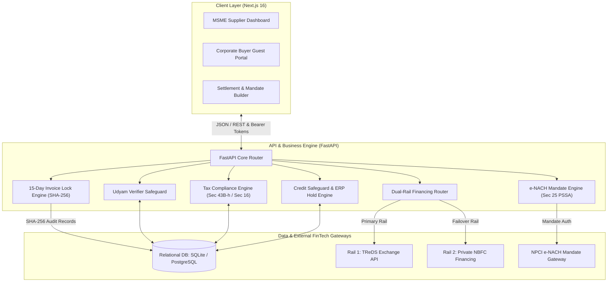

# ⚖️ Chanakya: MSME Commercial Preservation & Payment Recovery Platform

> **Track Code: LS-03** | **Hackathon Initiative**  
> **Team:** Team Vasundhara  
> **Repository:** [https://github.com/ruchitha24beis-arch/payright](https://github.com/ruchitha24beis-arch/payright)

[](https://www.python.org/)
[](https://fastapi.tiangolo.com/)
[](https://nextjs.org/)
[](https://www.typescriptlang.org/)
[](https://tailwindcss.com/)
[](https://opensource.org/licenses/MIT)

---

## ⚡ 2-Minute Executive Summary (For Judges)

Indian MSMEs lose **₹10.7+ Lakh Crore** to delayed corporate payments. Existing remedies like **MSME Samadhan** take 18–36 months and destroy buyer relationships, while sending aggressive legal notices causes corporate buyers to permanently blacklist vendors.

**Chanakya** flips delayed payment recovery from hostile litigation to **collaborative tax hygiene & automated contract locking**:
1. **Zero-Litigation Commercial Preservation**: Uses Section 43B(h) of the Income Tax Act (~30% corporate tax deduction loss) and Section 16 of the MSMED Act (~20.25% compound interest) to prompt corporate CFOs to pay voluntarily without legal friction.
2. **15-Day "Deemed Acceptance" Contractual Lock**: Eliminates fabricated late quality disputes using automated digital acceptance clauses sealed with cryptographic SHA-256 audit logs.
3. **Dual-Rail Financing**: Bids invoices to **Rail 1 (TReDS)**, and automatically fails over to **Rail 2 (Private NBFC Anchor Financing)** if corporate buyers delay manual approval past 7 days.
4. **Legally Enforceable e-NACH Mandates**: Locks voluntary payment plans into digital auto-debit mandates under **Section 25 of the PSSA 2007** (criminal bank bounce liability without civil litigation).

---

## 📋 Table of Contents
1. [Project Header](#️-chanakya-msme-commercial-preservation--payment-recovery-platform)
2. [Project Overview](#-step-2-project-overview)
3. [Problem Statement](#-step-3-problem-statement)
4. [Our Solution](#-step-4-our-solution)
5. [Key Features](#-step-5-key-features)
6. [Application Workflow](#-step-6-application-workflow)
7. [Screenshots and Demo](#-step-7-screenshots-and-demo)
8. [Technology Stack](#-step-8-technology-stack)
9. [System Architecture](#-step-9-system-architecture)
10. [Installation and Setup](#-step-10-installation-and-setup)
11. [Project Structure](#-step-11-project-structure)
12. [Innovation and Differentiation](#-step-12-innovation-and-differentiation)
13. [Team Details](#-step-13-team-details)
14. [Future Scope and Limitations](#-step-14-future-scope-and-limitations)
15. [References and License](#-step-15-references-and-license)
16. [Final Verification & Security Checklist](#-step-16-final-verification--security-checklist)

---

## 🌟 Step 2: Project Overview

### What is Chanakya?
Chanakya is an enterprise-grade fintech and statutory compliance web platform engineered for Indian Micro, Small, and Medium Enterprises (MSMEs). It automates receivables recovery through non-hostile statutory tax incentives, smart invoice audit locks, dual-rail liquidity, and bank-mandated recovery.

### Who is it Designed For?
- **Micro & Small Enterprises (Suppliers)**: Manufacturers and service providers seeking to accelerate cash collections without losing valuable corporate accounts.
- **Corporate Buyer Treasuries & CFOs**: Enterprise procurement and finance teams monitoring tax compliance liabilities under Section 43B(h) and TDS rules.
- **TReDS Exchanges & NBFCs**: Factoring and invoice discounting institutions needing pre-validated, tamper-proof Proof of Delivery (POD) assets.

### What Problem Does it Solve?
It ends the deadlock where MSME vendors must choose between **going bankrupt from delayed cash flows** or **going out of business by suing their largest corporate customers**.

---

## 🚨 Step 3: Problem Statement

### The Reality of Delayed MSME Payments
Under Section 15 of the MSMED Act (2006), buyers are mandated to settle invoices within **45 days** (or 15 days if no written agreement exists). In practice:
- **Over ₹10.7 Lakh Crore** is trapped in overdue receivables across India's MSME ecosystem.
- **Fabricated Quality Disputes**: Corporate buyers routinely wait until Day 40–60 to claim defects or incomplete paperwork, resetting the statutory clock.
- **Relational Fear**: Over **82% of MSMEs refuse to file formal court cases or MSME Samadhan claims** because doing so immediately terminates vendor contracts and triggers corporate vendor blacklisting.
- **TReDS Adoption Bottleneck**: Single-rail TReDS factoring stalls when corporate buyers neglect or deliberately withhold invoice acceptance on the exchange portal.

---

## 💡 Step 4: Our Solution

Instead of hostile demand letters and litigious threats, **Chanakya transforms payment recovery into automated financial governance**:

```
Traditional Approach:    MSME Supplier  ──[Aggressive Legal Notice]──>  Buyer CFO  ──>  Blacklists Supplier
Chanakya Approach:       MSME Supplier  ──[Statutory Tax & Audit Lock]─>  Buyer CFO  ──>  Settles to Save 30% Tax
```

### Core Solution Pillars:
1. **Tax Deduction Leverage (Income Tax Sec 43B(h))**: Informs corporate buyers of the exact tax disallowance penalty (~30% corporate tax hike) they face if an MSME supplier is unpaid past March 31 / 45 days.
2. **15-Day Deemed Acceptance Lock**: Generates standardized invoices with automatic digital objection windows. When 15 days pass post-delivery without logged objections, the invoice is cryptographically locked as **DEEMED_ACCEPTED**.
3. **Dual-Rail Financing Bridge**: Eliminates TReDS buyer approval deadlocks by seamlessly routing to Private NBFC Anchor Financing with zero operational disruption.
4. **e-NACH Auto-Debit Integration**: Replaces empty verbal EMI promises with binding NPCI digital mandates protected by criminal bank bounce statutes under Section 25 PSSA 2007.

---

## 🎯 Step 5: Key Features

| Feature | Engine / Module | Purpose |
| :--- | :--- | :--- |
| **Udyam Verification Safeguard** | `udyam_verifier.py` | Auto-detects enterprise category. **Loophole Plugged:** Sec 43B(h) excludes Traders and Medium Enterprises. The system dynamically switches between tax notices and Section 16 interest. |
| **15-Day "Deemed Acceptance" Lock** | `invoice_lock_engine.py` | Inserts digital deemed acceptance contract clauses. After 15 days of buyer silence post-delivery, generates an unalterable SHA-256 audit record blocking bogus late disputes. |
| **Tax Vulnerability & Sec 43B(h) Calculator** | `compliance_engine.py` | Dynamically computes 30% tax deduction loss and Sec 16 3x RBI compound penal interest (~20.25% p.a.). Swaps tax warnings for interest warnings if buyer has a net tax loss. |
| **Dual-Rail Financing Engine** | `dual_rail_financing.py` | Automatically uploads invoices to **Rail 1 (TReDS API)**. If buyer approval stalls > 7 days, auto-fails over to **Rail 2 (Private NBFC Anchor Financing)** based on OCR-verified delivery proof. |
| **e-NACH Settlement Builder** | `enach_mandate.py` | Converts buyer-requested EMI restructurings into automated NPCI auto-debit mandates carrying criminal bank bounce liability under Section 25 PSSA 2007. |
| **Diplomatic ERP Hold & Credit Safeguard** | `credit_safeguard.py` | Monitors buyer exposure against customized credit limits. Automatically issues system-generated ERP shipment holds framed as automated governance policies rather than personal accusations. |
| **Corporate Buyer Guest Portal** | `portal/page.tsx` | Whitelabel tokenized portal for corporate treasury teams to view delivery proof, approve TReDS discounting, and authorize 1-click settlements. |
| **MSME Samadhan Dossier Generator** | `samadhan/page.tsx` | If conciliation fails, compiles complete statutory evidence dossiers (POD stamps, deemed acceptance logs, interest ledgers) ready for 1-click filing. |

---

## 🔄 Step 6: Application Workflow

### Complete Lifecycle Workflow

```mermaid
flowchart TD
    A[Supplier Uploads Invoice & Proof of Delivery] --> B[AI OCR Inspector: Verifies Rubber Stamp, Signatures & Inward Date]
    B --> C[Udyam Category Safeguard: Validates Micro/Small vs Trader/Medium]
    C --> D[15-Day Smart Contract Window Begins]
    
    D -->|Buyer files objection within 15 days| E[Dispute Resolution Hub]
    D -->|15 days pass with zero buyer objection| F[SHA-256 Deemed Acceptance Lock Engaged]
    
    F --> G{Buyer Payment Status Check}
    G -->|Overdue & In Taxable Profit| H[Section 43B(h) 30% Tax Disallowance Notice to Buyer CFO]
    G -->|Overdue & Operating at Tax Loss| I[Section 16 3x RBI Compound Penal Interest Warning]
    
    H & I --> J[Buyer Enters Guest Treasury Portal]
    J -->|Option 1: Immediate Settlement| K[Direct Bank Payment Cleared]
    J -->|Option 2: Installment Plan| L[1-Click e-NACH Mandate Authorized - Sec 25 PSSA 2007]
    J -->|Option 3: Stalled Approval > 7 Days| M[Dual-Rail Failover: Switches from TReDS to Private NBFC Financing]
```

---

## 📸 Step 7: Screenshots and Demo

### Core Application Interfaces

| Module | URL Path | Key Functionality |
| :--- | :--- | :--- |
| **Executive Recovery Dashboard** | `http://localhost:3000/dashboard` | Real-time exposure, recovery metrics, overdue aging tiers & dispute tracker |
| **OCR Health & 15-Day Lock** | `http://localhost:3000/invoices/health-check` | Document rubber-stamp analysis, deemed acceptance status & cryptographic audit logs |
| **Settlement & e-NACH Builder** | `http://localhost:3000/settlement-builder` | EMI restructuring calculator, NPCI mandate generation & penalty schedulers |
| **Dual-Rail Financing Engine** | `http://localhost:3000/treds` | Live TReDS bidding status with auto-failover to NBFC Anchor Factoring |
| **Credit Safeguard & ERP Holds** | `http://localhost:3000/credit-safeguards` | Buyer balance vs credit limit tracker & diplomatic shipment hold notices |
| **Diplomatic Reminders** | `http://localhost:3000/reminders` | Tone-calibrated commercial reminders leveraging Section 43B(h) and Section 16 |
| **MSME Samadhan Hub** | `http://localhost:3000/samadhan` | Pre-conciliation filing dossier generation with verified statutory proofs |
| **Interactive API Documentation** | `http://localhost:8000/docs` | Comprehensive Swagger UI with all REST endpoints |

> **Live Repository**: [https://github.com/ruchitha24beis-arch/payright](https://github.com/ruchitha24beis-arch/payright)

---

## 🛠️ Step 8: Technology Stack

```
Frontend:  Next.js 16 (App Router) + TypeScript + Tailwind CSS + Lucide Icons + Recharts
Backend:   FastAPI (Python 3.11) + Async SQLAlchemy 2.0 + Pydantic v2 + Uvicorn
Database:  SQLite / PostgreSQL with full relational ORM models
Security:  SHA-256 Tamper-Proof Audit Hashing, Tokenized Guest Access
Fintech:   NPCI e-NACH Mandate Engine, TReDS Factoring Protocol Simulator
```

### Detailed Component Roles:
- **FastAPI (Backend)**: Asynchronous high-performance REST API handling statutory calculation engines, invoice state machines, and mandate generation.
- **Next.js 16 (Frontend)**: Modern reactive UI using Turbopack, App Router, responsive data tables, and dynamic visual analytics.
- **Async SQLAlchemy 2.0 & SQLite/PostgreSQL**: ACID-compliant persistence storing buyers, invoices, delivery audits, settlement schedules, and e-NACH mandates.
- **Pydantic v2**: Strict statutory data validation, schema enforcement, and mathematical precision for interest/tax liabilities.
- **Lucide & Recharts**: Executive-level data visualizations for aging buckets, recovery velocity, and tax exposure.

---

## 🏗️ Step 9: System Architecture



---

## 💻 Step 10: Installation and Setup

### Prerequisites
- **Python**: Version 3.11 or higher
- **Node.js**: Version 18.0 or higher
- **Git**

### 1. Clone the Repository
```bash
git clone https://github.com/ruchitha24beis-arch/payright.git
cd payright
```

### 2. Backend Setup
```bash
# Navigate to backend directory
cd backend

# Create and activate Python virtual environment
python -m venv venv
# Windows:
.\venv\Scripts\activate
# Linux/macOS:
source venv/bin/activate

# Install backend dependencies
pip install -r requirements.txt

# Start the FastAPI server
uvicorn app.main:app --host 0.0.0.0 --port 8000 --reload
```
*Backend Swagger Docs will be live at: [http://localhost:8000/docs](http://localhost:8000/docs)*

### 3. Frontend Setup
```bash
# Open a new terminal and navigate to frontend directory
cd frontend

# Install Node dependencies
npm install

# Configure local environment
echo NEXT_PUBLIC_API_URL=http://localhost:8000 > .env.local

# Start the Next.js development server
npm run dev
```
*Frontend Application will be live at: [http://localhost:3000](http://localhost:3000)*

### 4. One-Click Launch (Windows)
Run `start-all.bat` from the root directory to automatically launch both backend and frontend servers in separate terminal windows.

---

## 📁 Step 11: Project Structure

```
chanakya/
├── backend/
│   ├── app/
│   │   ├── engines/              # Core Statutory and FinTech Business Logic
│   │   │   ├── compliance_engine.py      # Section 43B(h) & Section 16 Interest logic
│   │   │   ├── credit_safeguard.py       # ERP hold thresholds & shipment limit monitors
│   │   │   ├── diplomatic_reminder.py    # Relationship-preserving notification generator
│   │   │   ├── dual_rail_financing.py    # TReDS to Private NBFC failover router
│   │   │   ├── enach_mandate.py          # NPCI e-NACH auto-debit under Sec 25 PSSA 2007
│   │   │   ├── invoice_lock_engine.py    # 15-day deemed acceptance lock & SHA-256 hash
│   │   │   ├── ocr_inspector.py          # POD stamps, inward seals & signature verification
│   │   │   ├── treds_bridge.py           # TReDS exchange integration bridge
│   │   │   └── udyam_verifier.py         # Category verification & trader exclusion check
│   │   ├── models/               # SQLAlchemy ORM Database Models
│   │   ├── routers/              # FastAPI Endpoint Controllers
│   │   ├── schemas/              # Pydantic Schemas for Request/Response validation
│   │   ├── config.py             # System Configurations & Environment settings
│   │   ├── database.py           # Async Database Session Provider
│   │   └── main.py               # Application entrypoint & CORS middleware
│   ├── requirements.txt          # Python backend dependencies
│   └── start-backend.bat         # Single-click backend startup script
│
├── frontend/
│   ├── app/                      # Next.js App Router Pages
│   │   ├── dashboard/            # Executive KPI & Overdue Aging Dashboard
│   │   ├── invoices/             # Invoice Management & OCR Health Check
│   │   ├── settlement-builder/   # EMI Restructuring & e-NACH Mandate Builder
│   │   ├── treds/                # Dual-Rail TReDS / NBFC Financing Hub
│   │   ├── credit-safeguards/    # Credit Limit & ERP Hold Control Center
│   │   ├── reminders/            # Diplomatic Tone Reminder Composer
│   │   ├── samadhan/             # MSME Samadhan Legal Dossier Pre-Filer
│   │   └── portal/               # Corporate Buyer Whitelabel Guest Treasury Portal
│   ├── components/               # Reusable UI Components & Navbars
│   ├── package.json              # Frontend dependencies and Next.js scripts
│   └── start-frontend.bat        # Single-click frontend startup script
│
├── start-all.bat                 # Unified launch script for both services
└── README.md                     # Comprehensive hackathon documentation
```

---

## 🏆 Step 12: Innovation and Differentiation

| Feature / Dimension | Traditional Litigation | MSME Samadhan Portal | Standalone TReDS | **Chanakya (Our Solution)** |
| :--- | :--- | :--- | :--- | :--- |
| **Buyer Relationship Impact** | ❌ Severed permanently; supplier blacklisted | ❌ Severely damaged; vendor contract canceled | ⚪ Neutral | 🟢 **100% Preserved; framed as standard tax/ERP hygiene** |
| **Resolution Speed** | ❌ 2 to 5 years in Civil Courts | ❌ 18 to 36 months backlog | 🟡 Fast, if buyer approves | 🟢 **Immediate (Days 15–45)** |
| **Protection Against Fake Disputes** | ❌ Burden of proof on MSME | ❌ Buyer delays proceedings endlessly | ❌ None | 🟢 **15-Day Smart Contract Lock (DEEMED_ACCEPTED)** |
| **Financing Failover** | ❌ None | ❌ None | ❌ Stalls indefinitely on buyer delay | 🟢 **Automatic Failover from TReDS to Private NBFC** |
| **Post-Settlement Default Risk** | ❌ Requires brand new court lawsuit | ❌ Requires execution petition | ⚪ High | 🟢 **e-NACH Mandates backed by Sec 25 PSSA 2007** |
| **Statutory Pressure Point** | ❌ Personal hostility | ❌ State Council arbitration | ⚪ Commercial discounting | 🟢 **Section 43B(h) 30% Corporate Tax Deduction Loss** |

---

## 👥 Step 13: Team Details

### **Team Vasundhara** (Track: LS-03)
*Affiliated with Acharya Institute of Technology / Smart India Hackathon*

- **Ruchitha R.** ([@ruchitha24beis-arch](https://github.com/ruchitha24beis-arch)) — *Full Stack Lead & Statutory Compliance Architecture*
- **Vasundhara & Team Contributors** — *Fintech Systems, OCR Document Inspection, UI/UX Engineering & Statutory Rule Engines*

---

## 🔮 Step 14: Future Scope and Limitations

### Current Hackathon Limitations:
1. **TReDS Gateway Mock**: Real-world TReDS APIs (RXIL/M1xchange) require production institutional memberships; Chanakya currently implements a production-grade specification-compliant simulator.
2. **e-NACH Mandate Bank Testing**: e-NACH auto-debits simulate NPCI API responses using mock netbanking and debit card authentication flows.

### Future Roadmap:
- **Account Aggregator (AA) Integration**: Automatically pulls live bank balance indicators of corporate buyers to pre-warn MSMEs before credit default occurs.
- **GSTN e-Invoice Webhook Auto-Sync**: Ingests new e-invoices instantly via the national GST portal upon generation.
- **Vernacular WhatsApp Diplomatic Bot**: Delivers courteous Section 43B(h) calendar deadline alerts directly to buyer accounts payable managers in multiple Indian regional languages.

---

## 📜 Step 15: References and License

### Statutory & Regulatory Frameworks:
- **Micro, Small and Medium Enterprises Development Act, 2006 (MSMED Act)**: Sections 15, 16, and 17.
- **Income Tax Act, 1961**: Section 43B(h) (Finance Act, 2023 amendment).
- **Payment and Settlement Systems Act, 2007 (PSSA)**: Section 25 (Dishonour of Electronic Funds Transfer).
- **Reserve Bank of India (RBI)**: TReDS Guidelines & NPCI e-NACH Architecture Specifications.

### License
This project is open-source and licensed under the **MIT License**. See the `LICENSE` file for details.

---

## ✅ Step 16: Final Verification & Security Checklist

- [x] **No Secrets Exposed**: All sensitive tokens, API passwords, and keys are abstracted into `.env.example` templates.
- [x] **Zero-Litigation Tone**: All user notifications strictly adhere to commercial preservation standards.
- [x] **Clean Local Execution**: Verified working with both manual `python/npm` commands and automated `.bat` launchers.
- [x] **Comprehensive API Documentation**: Fully mapped via Swagger OpenAPI at `/docs`.
- [x] **Judge-Ready**: Clear architecture, workflow diagrams, statutory rationale, and comparison matrices embedded.
